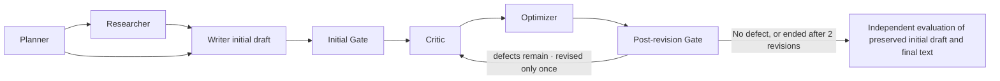

> Appendix copy of `../tools/final125_v1/README_EN.md` (2026-10-16). Only one Korean diagram label is translated and relative links are adjusted; the original file is unchanged.

> English translation prepared 2026-09-17 of `README.md`. The Korean original is the recorded/frozen document; where wording differs, the original governs.

> Note added to this appendix copy on 2026-11-23: this guide is kept as it was written before the registration, which was completed afterwards as AsPredicted #310130 (2026-09-07). There is no GitHub release, Zenodo record or DOI; the materials are provided in this repository.

# Study E Final Experiment Execution Guide

This folder is for the new final experiment. The code, texts, and scores of existing pilots are preserved. The current plan is **125 natural generations ＋ 52 defect and 73 unchanged tasks from the same initial drafts**, and the two conditions are not merged into 250 independent samples. AsPredicted registration has not yet been completed.

## Actual execution path

In the natural condition, LangGraph connects the following roles. Both the Planner's original plan and the Researcher ledger are passed to the Writer.



- **The first revision is mandatory for every text**, up to 2 at most. Even if the Critic instruction is empty, the Optimizer is called. There is no regeneration until residual defects are removed or the text passes.
- The natural condition has 4 batches of 31/31/31/32. After each batch the Lesson Curator is called 1 time, and the lessons are passed to the next batch. Initially the lesson ledger is empty.
- The mixed condition uses the natural condition's **Writer initial drafts**. Four defect types are injected, 13 each, into the fixed 52, and 73 are left as is. Initial and final texts receive new independent evaluation, and there are no new Planner/Researcher/Writer/Curator calls. The original task's plan, evidence, and selected lessons are reused.
- Independent-evaluation scores are not passed to production, revision, or lessons. If title and body are exactly identical, the initial evaluation of that run is reused as the final evaluation.
- Body target 1200–1500 characters, hard valid range 150–2000 characters. Whitespace and line breaks are included and the title is excluded.

## Preparation and freeze

**On resumption on 2026-09-07, the first step is same-day pricing evidence. Do not run `freeze` before the price comparison is complete.** Follow the order below.

1. Confirm the actual API request model IDs and billing path, and look up the official pricing page for each unique model in use on 2026-09-07. The current assignment is Haiku4.5 (Planner), Opus5 (Researcher), GPT-5.4 Mini (Writer/Critic/Optimizer), GPT-5.4 (Gate/Curator), Gemini3.8Flash (independent evaluator). If there is a separate API intermediary path/rate, distinguish the actually applied price from the provider's official price.
2. Save the model ID, provider, role, input/output/cache unit prices, currency/unit, applicable context and service conditions, official URL, and lookup time (UTC and Europe/Berlin) as a table and JSON. Also save actual screenshots in which the page's price rows and applicable conditions are legible. If the page has no update date, do not use the lookup date as the update date.
3. The save location is `private/final125_v1/pricing/2026-09-07/`. Preserve a SHA256 manifest of the price table, URL/time, and screenshots. Do not substitute today's September 6 prices or the existing pilot unit prices for the September 7 verification evidence. Items whose exact model/rate could not be confirmed on the official page are marked unverified and are not frozen at estimated prices.
4. Compare the price table against all unit prices used in actual calls, cost calculation, and pre-call reservation. If there are changes, preserve the previous configuration before registration/execution and record the reason for the change and the before/after values. Re-compare the expected cost of natural 125＋mixed 125 with the USD49.99 cap. Do not arbitrarily expand the cap.
5. Include the pricing evidence files and the actually applied unit prices in the final freeze manifest, update the offline check with the modified source/config, and then proceed in the order local freeze→actual AsPredicted registration→paid execution. This step is complete only once inclusion of the pricing materials in the freeze has also been confirmed.

The 2026-09-07 official price comparison and the implementation/Cloud re-lookup below have been completed. Obtaining actual page screenshots, computing the expected total cost of the two conditions, and the final freeze/registration have not yet been completed.

The single price ledger of the final run is `private/final125_v1/pricing.json`. `pricing.py` computes pre-call reservation, cost conversion of response usage, and Langfuse model prices all from this file. The Gate's incorrect cache-write reservation unit price of 3.125 was corrected to 2.5 to unify it with the Curator on the same GPT-5.4. Existing pilot helpers are preserved, and the final runner recomputes both successful and validation-failed responses at the central unit prices. OpenAI requests explicitly specify the standard `service_tier=default`. A plan/price hash mismatch, unverified usage or service rate, and expiry of the Gemini introductory price halt execution. Pre-correction copies and resolution records are in `private/final125_v1/pricing_changes/`.

On 2026-09-07 the per-token unit prices of five custom models were registered in the new Langfuse project and looked up again. Input, cache read, cache write, output, and thinking are split without duplication, and local `cost_details` are sent directly to the generation. The GPT-5.4 long-context tier and Anthropic cache-retention-period rates are also reflected. The verification receipt is `private/final125_v1/langfuse_pricing_verification_2026-09-07.json`. The 7 synthetic generations were stored in the `pricing-verification` environment and are excluded from the final experiment. The displayed test costs are calculation fixtures, and actual paid model calls are 0.

API errors, timeouts, and response validation failures are recorded as the generation's `ERROR`, status, error type/provider code, and a validation description where possible. Content defects are preserved as Gate output and are not in themselves technical errors. When cost is unverified, tokens are kept only in metadata and do not trigger Cloud automatic cost conversion. Langfuse transmission errors are left in local `telemetry_events/` and are not regarded as guaranteeing Cloud receipt.

The commands below are run from the repository root. `prepare`, `offline_check`, and `freeze` do not call models.

```powershell
python studies/study_e_redesign/tools/final125_v1/run.py prepare
python studies/study_e_redesign/tools/final125_v1/offline_check.py
python studies/study_e_redesign/tools/final125_v1/run.py freeze
```

`requirements.lock.txt` is the exact version list to be verified in this run. Do not mix-install with other environments of the existing root project. The offline check verifies all `test_*.py`, the analysis self-check, installed versions, and source/plan hashes before and after execution. The Mermaid generated by the actual LangGraph and the logs/receipts are preserved by timestamp in `private/final125_v1/offline_checks/`. `offline_test_receipt.json` is a replaceable index to the latest check.

**After finalizing the code, plan, and analysis criteria and actually registering on AsPredicted**, record the issued ID and URL. Replace the placeholders below with the actual values. This command itself does not submit to AsPredicted.

```powershell
python studies/study_e_redesign/tools/final125_v1/run.py record-registration --id ACTUAL_ID --url https://aspredicted.org/ACTUAL_URL
```

The runner does not start paid calls if the registration receipt and the freeze hash do not match. A local freeze or a Git commit alone is not marked as completed pre-registration.

## Execution and resumption

```powershell
python studies/study_e_redesign/tools/final125_v1/run.py execute --condition both
```

If needed, this can be split into `--condition natural` and then `--condition mixed`. The mixed condition requires the originals of the natural 125 to be ready. On resumption with the same command, stored successful calls are reused. Do not start another duplicate runner while one is running.

- The combined budget ledger cap for the two new conditions is **USD49.99**. Past pilot costs are preserved separately. Independent evaluation, failures, and reservations for unknown usage are also managed within the new run's cap.
- Budget is reserved before each request and raw attempts/results are preserved. The current settings are 12 schema failures, 7 transport failures, and a maximum of 24 429-related call loops in the resume window. Global call and budget caps persist after resumption. On balance exhaustion, stop immediately, and never retry because of scores.
- Actual Langfuse authentication is required. The configuration uses `LANGFUSE_PUBLIC_KEY`, `LANGFUSE_SECRET_KEY`, and `LANGFUSE_HOST` or `LANGFUSE_BASE_URL` from the existing root `.env`, and the keys are not printed or disclosed.
- Each actual API attempt is recorded as a Langfuse generation. Local results are saved first and then telemetry is updated, so a transmission failure does not repeat the same model call. The local usage/cost ledger, rather than the Cloud screen's automatically estimated cost, is the analysis reference.
- The `study-e-final125-implementation-smoke` trace for implementation verification is not final experiment data. `telemetry_preflight.json` is the receipt of that actual Cloud verification.
- On 2026-09-07, the root `.env` was switched to the new Langfuse project. The latest connection evidence is `private/final125_v1/telemetry_reconnect_2026-09-07.json`. Authentication and re-lookup of the test trace completed (1 SPAN, 0 generations, 0 paid model calls). The existing `telemetry_preflight.json` is preserved as history of the previous project. Connection-verification traces are excluded from the final experiment analysis.

## Technical recovery

On interruption, leave successful responses and failed attempts as they are. If code must be fixed, review the before/after difference and impact, pass the offline check again with the current code, and then leave a recovery receipt.

```powershell
python studies/study_e_redesign/tools/final125_v1/offline_check.py
python studies/study_e_redesign/tools/final125_v1/run.py record-recovery --kind transport --reason "<specific cause, fix, and affected scope>"
python studies/study_e_redesign/tools/final125_v1/run.py execute --condition both
```

The recovery kinds are `transport`, `serialization`, `checkpoint_recovery`, and `telemetry`. The allow-list does not automatically prove scientific equivalence. Changing models, items, prompts, rubric, revision policy, or analysis criteria is not recorded as simple operational recovery and is handled as a separate protocol/version.

## Outputs

`private/final125_v1/` holds the preparation plan and topic list, `started/` requests, `results/` responses/usage/failures, `tasks/` initial/final texts and evaluations, `batches/` lessons, mixed originals and transformed diffs, and execution/telemetry/recovery receipts. Analysis is performed in `analysis.py`. It distinguishes H1 technical completion from quality pass, natural full production cost from mixed revision-path cost, and defect recovery from deterioration of sound texts.

API raw text, failures, and costs are not corrected. The current materials are stored separately from development/pilot data, and the final results, code, and manifest are linked to the paper's corresponding GitHub release and Zenodo version.

If production finished before an evaluation failure, the completed state is preserved in `production/`. The reporter reads the evaluation-complete records in `tasks/` first, and uses the production checkpoint if absent. The not-started/incomplete 125 denominator and unknown cost are also retained.

```powershell
python studies/study_e_redesign/tools/final125_v1/report.py --workspace studies/study_e_redesign/private/final125_v1 --output studies/study_e_redesign/private/final125_v1/reports
```

Generates per-condition natural/mixed analysis JSON, the 125-row task O/X, per-role cost/reservation, the batch Curator table, and raw-data hashes. A `not_started` report is a prepared state and not a final experiment result. On text freeze or operational recovery, the before/after code and patch diffs in `source_archive/` are preserved.

## Final numerical scope: Proposal-specified items only

2026-09-07 decision: Langfuse is used as evidence of the execution process, failures, retries, and critique and revision cases. Cases link the task ID, call ID/trace, and local raw data. Final figures are computed from the local ledger including all 125 scheduled tasks and the fixed analysis code. This decision does not introduce new evaluation calls, Scores integration, or additional hypothesis tests. Cases are not used as grounds for claiming statistical representativeness or the causal effect of a specific role or lesson.

Following the 2026-09-06 follow-up decision, the scope of No. 219 (`219_PROPOSAL_ONLY_ANALYSIS_DECISION_EN.md`, not linked) is applied. Only the H1–H3 observed criteria, descriptive statistics, four-dimension quality and total score, cost and latency, Flesch ease/grade, word count, TTR, and the paired total-score Wilcoxon (two-sided α=.05) are computed. Wilson/bootstrap/McNemar/Hoeffding and the secondary tables of Gate×independent evaluation and Gate-passed subsets are excluded from the final report. Past pilot results are preserved.

If initial low quality is 0, H3 is undefined; if an evaluation pair is missing, H3 and the Wilcoxon for the full 125 are undetermined; if production-cost usage is unknown, H2 is reported as undetermined. The Wilcoxon does not directly test the 30% boundary of H3. All raw texts, raw scores, attempts, O/X, lessons, and cost/reservation records continue to be preserved.
